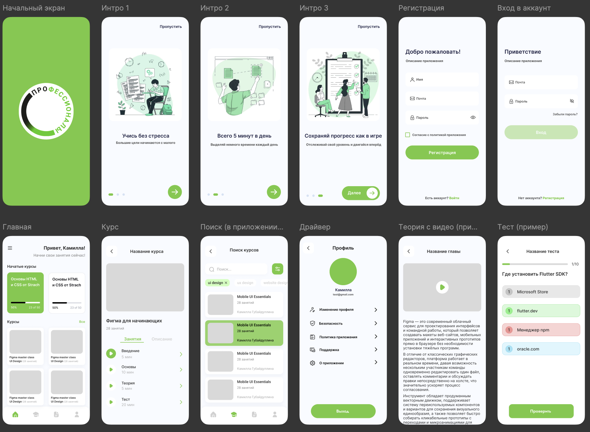

# Checkpoint

**Мобильное приложение для изучения мобильной разработки и подготовки к Региональному чемпионату «Профессионалы» (РЧ)**

Проект выполнен для студенческой научно-практической конференции **«Я — Специалист»**.

---

## О проекте

Checkpoint помогает студентам готовиться к региональному чемпионату по компетенции «Мобильная разработка». Обучение построено на коротких занятиях: человек уделяет учёбе по 5 минут в день, видит свой прогресс и получает достижения, как в игре.

Приложение включает курсы по Dart, Flutter и Figma. Каждый курс разбит на занятия четырёх типов: видеоурок, теория, тест и опрос.

## Дизайн

   Макет приложения создан в Figma.

   
   
## Возможности

- Заставка и онбординг из трёх экранов с возможностью пропустить
- Регистрация и вход в аккаунт, согласие с политикой приложения, восстановление пароля
- Главная страница с начатыми курсами и прогрессом (например, «23 из 50»)
- Каталог курсов и поиск с фильтрацией по тегам
- Страница курса с вкладками «Занятия» и «Описание»
- Четыре типа занятий:
  - видеоурок;
  - теория с текстом;
  - тест с проверкой ответов и счётчиком вопросов;
  - опрос;
- Система достижений
- Профиль пользователя, боковое меню: изменение профиля, безопасность, политика приложения, поддержка, «О приложении»
- Сохранение пользовательских данных на устройстве

---

## Технологии

| Что | Чем |
|---|---|
| Язык | Dart |
| Фреймворк | Flutter |
| Платформа | Android (папка `android/`) |
| Дизайн | Figma |
| Контроль версий | Git, GitHub |

Список зависимостей находится в `pubspec.yaml`.

---

## Структура проекта

```
lib/
├── data/                  # данные
│   ├── models/            # модели: достижения, курсы, уроки, вопросы теста и опроса
│   ├── courseData.dart    # содержимое курсов
│   └── data.dart
├── domain/                # логика приложения
│   ├── globals.dart       # глобальные значения
│   ├── prefs.dart         # локальное хранилище
│   └── userWallet.dart    # данные пользователя
├── presentation/          # интерфейс
│   ├── screens/
│   │   ├── auth/          # регистрация и вход
│   │   ├── course/        # экраны курса
│   │   ├── drawer/        # разделы бокового меню
│   │   ├── lesson/        # видео, текст, тест, опрос
│   │   ├── home.dart
│   │   ├── search.dart
│   │   ├── profile.dart
│   │   ├── achievement.dart
│   │   ├── onboarding.dart
│   │   └── splash.dart
│   └── uikit/             # цвета, шрифты и общие компоненты
│       └── components/    # кнопка, поле ввода, карточка курса, таббар
└── main.dart              # точка входа
```

---

## Запуск проекта

### Требования

- [Flutter SDK](https://flutter.dev/docs/get-started/install)
- Android Studio или VS Code с плагинами Flutter и Dart
- Эмулятор Android или устройство с включённой отладкой по USB

### Шаги

```bash
# 1. Клонировать репозиторий
git clone https://github.com/eclpze/checkpoint.git
cd checkpoint

# 2. Установить зависимости
flutter pub get

# 3. Проверить окружение
flutter doctor

# 4. Запустить приложение
flutter run
```

### Сборка APK

```bash
flutter build apk --release
```

Готовый файл появится в `build/app/outputs/flutter-apk/app-release.apk`.

---

## Дизайн

Макеты экранов созданы в Figma: заставка, три экрана онбординга, регистрация, вход, главная, курс, поиск, профиль, видеоурок и тест. Основной цвет интерфейса зелёный, цвета и шрифты вынесены в `lib/presentation/uikit/`.

---

## Планы развития

- [ ] Перенести данные на внешнее хранилище
- [ ] Добавить курсы по подготовке к заданиям РЧ
